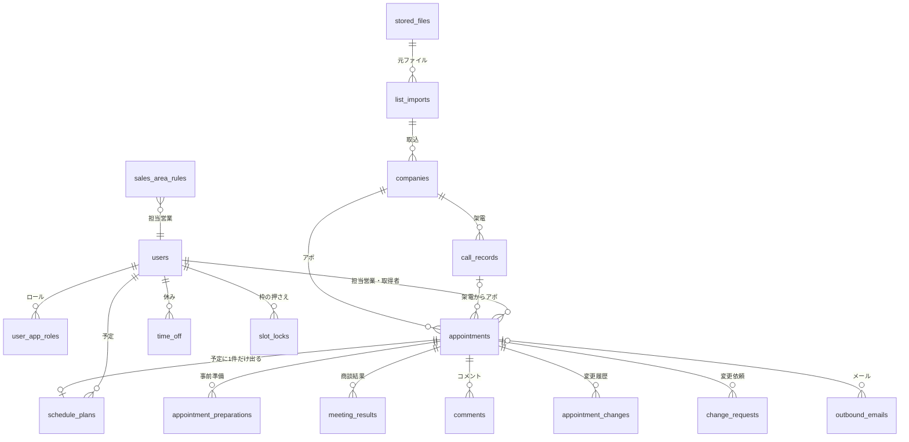
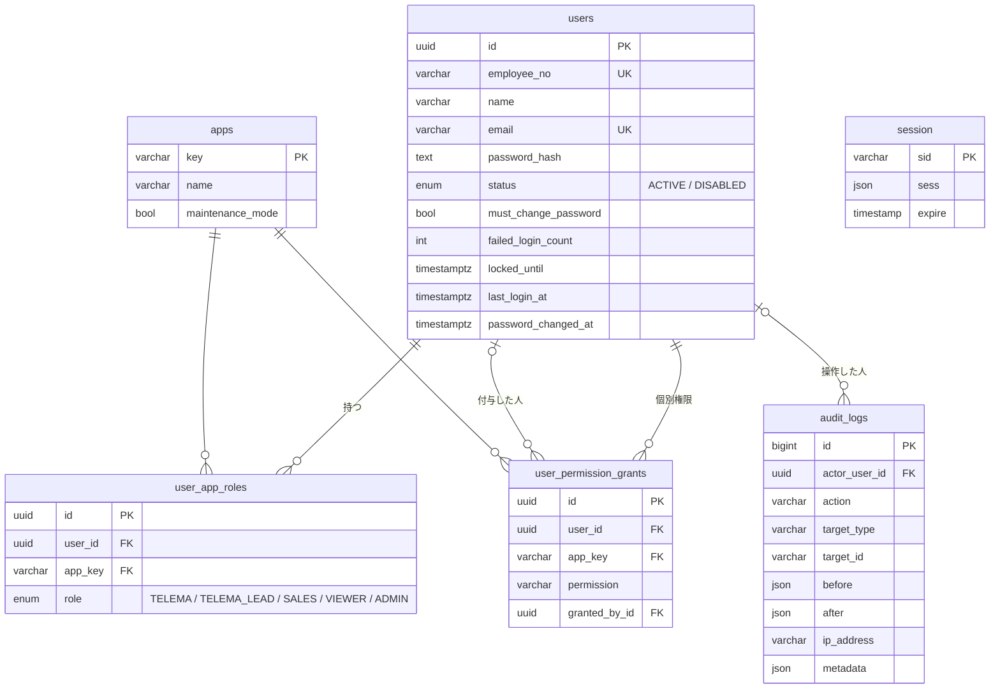
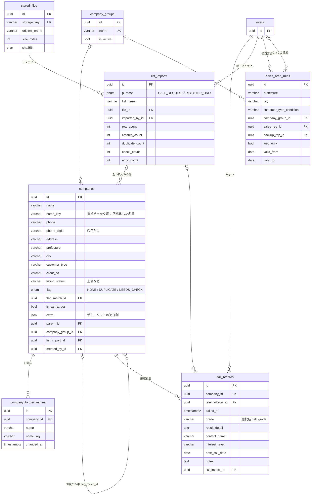
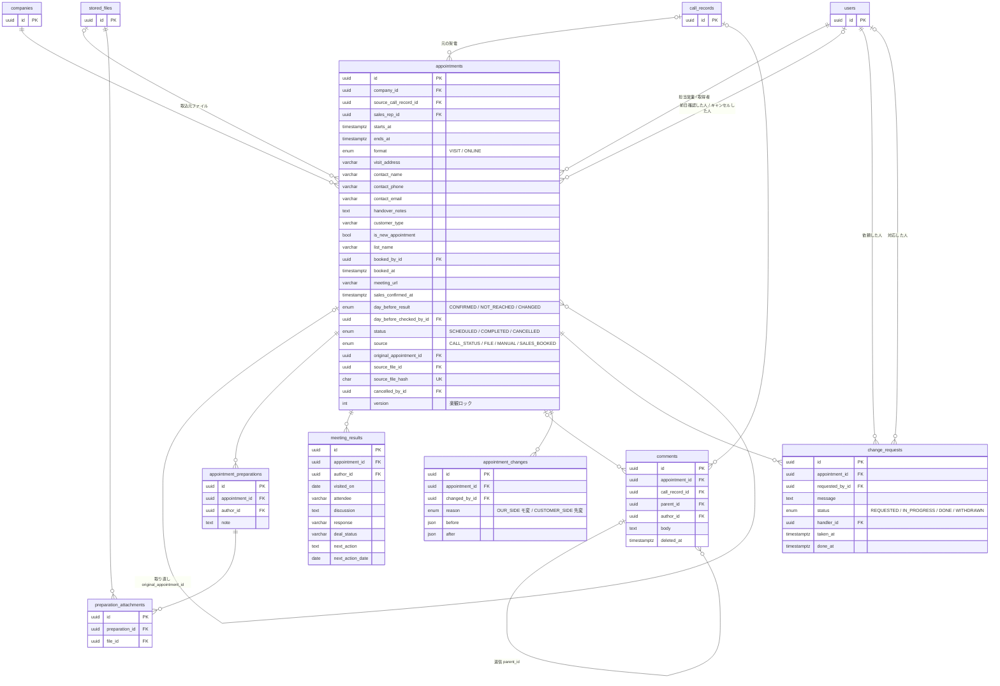
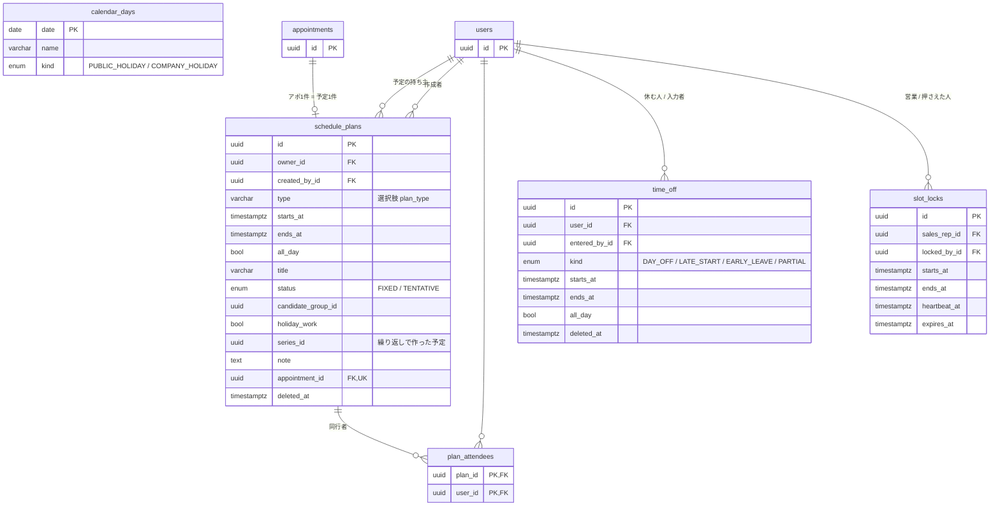
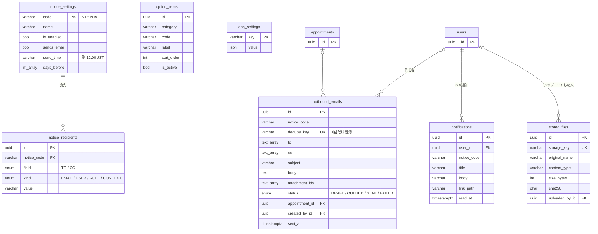
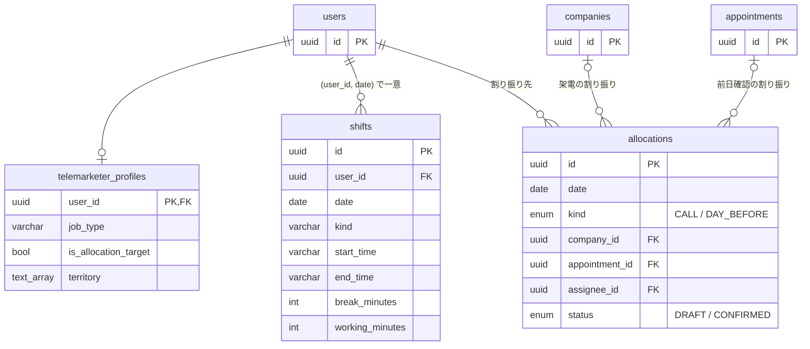

# ER 図（データベース）

`apps/api/prisma/schema.prisma` と `apps/api/prisma/migrations/` から作成しています。PostgreSQL 16 を使います。
User は多くのテーブルから参照されるため、図を業務ごとに分けています。どの図でも `users` は同じテーブルです。

記号の意味：`PK` 主キー、`FK` 外部キー、`UK` 一意。
`||--o{` は「1 対 0 件以上」、`|o--o{` は「0 か 1 対 0 件以上」です。

## 1. 全体像

## 2. ユーザー・権限・監査

- `user_app_roles` は (user_id, app_key, role) で一意です。1 人が複数のロールを持てます。
- `user_permission_grants` は「エリア表を任された人」のような個別の例外をデータで持ちます。
- `session` は connect-pg-simple 用です。列名は変えられません。

## 3. 架電状況共有（企業・リスト・架電）

- 電話番号が同じなら `DUPLICATE`（解消するまで架電対象から外します）、社名だけが同じなら `NEEDS_CHECK` です。
- 担当営業はエリア（都道府県・市区町村）、取引区分、企業グループ、有効期間から `sales_area_rules` で決めます。

## 4. アポ（データの中心）

- リスケは同じアポを動かして `appointment_changes` に前後の値を残します。新しいアポを作るのはキャンセル後の取り直しだけです（`original_appointment_id`）。
- `comments` は、アポか架電記録の**どちらか一方**に付きます（CHECK 制約）。
- `source_file_hash` が一意なので、同じファイルを二重に登録できません。

## 5. スケジュール

- 二重予約は次の順で防ぎます。
  1. 担当営業ごとの advisory lock
  2. `slot_locks` による枠の押さえ（ハートビートで延長し、120 秒で切れます）
  3. 最後の砦として、同じ持ち主の予定が時間帯で重ならないようにする `EXCLUDE USING gist` 制約
- `calendar_days` は営業日ではない日です。祝日は内閣府の CSV から取り込み、会社休日は管理者が入力します。

## 6. 通知・メール・設定・ファイル

- `option_items` は (category, code) で一意です。選択肢は削除せず無効にします。
- `app_settings` には移動時間バッファなどを持ちます。
- `outbound_emails.dedupe_key` の例は `N1:{アポID}`、`N4:{日付}:{営業ID}`、`N19:{日付}` です。

## 7. テレマ管理（優先度 2・テーブルのみ）

## DB 側の制約（マイグレーション SQL で追加）

| テーブル                                           | 制約                                                                                                                                                                                                             |
| -------------------------------------------------- | ---------------------------------------------------------------------------------------------------------------------------------------------------------------------------------------------------------------- |
| appointments, schedule_plans, time_off, slot_locks | `CHECK (ends_at > starts_at)`                                                                                                                                                                                    |
| comments                                           | `CHECK ((appointment_id IS NULL) <> (call_record_id IS NULL))`                                                                                                                                                   |
| schedule_plans                                     | `EXCLUDE USING gist (owner_id WITH =, tstzrange(starts_at, ends_at) WITH &&) WHERE appointment_id IS NOT NULL AND deleted_at IS NULL`：同じ営業のアポの予定が重ならないようにします（btree_gist 拡張を使います） |
